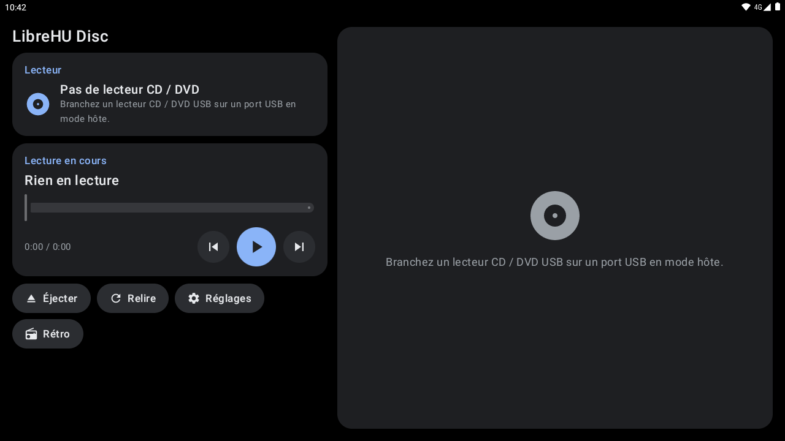
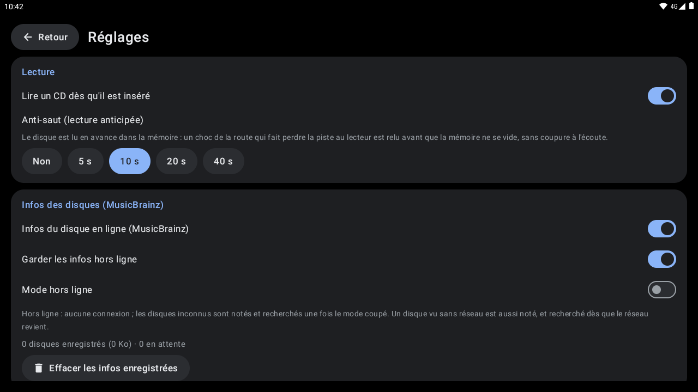
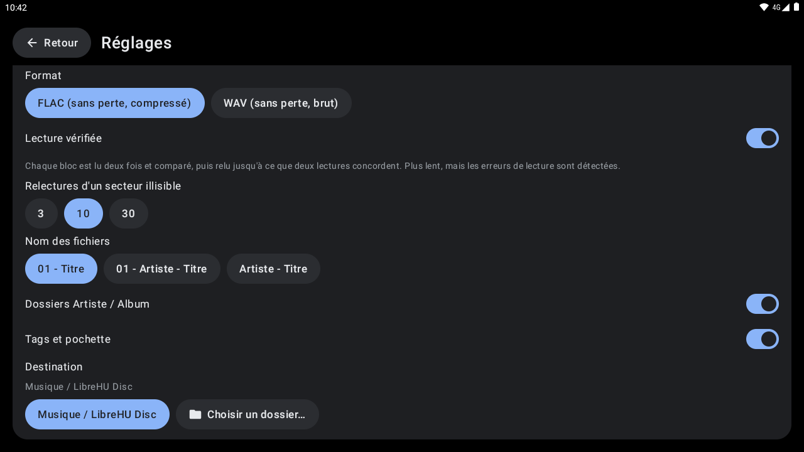
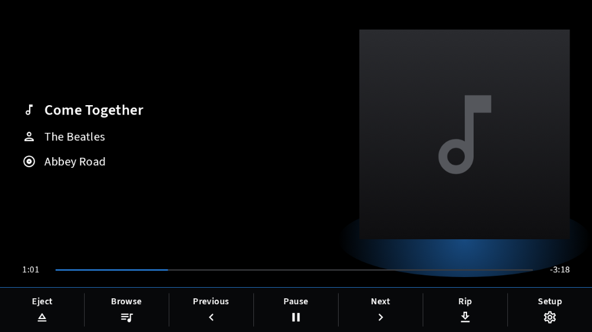
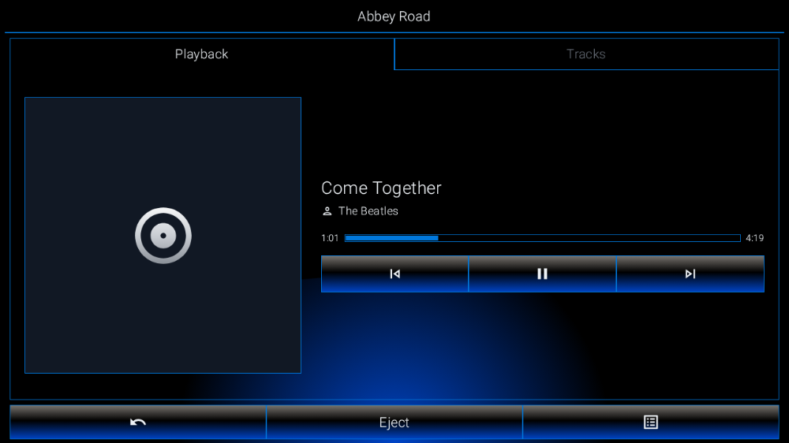

# LibreHU Disc

Lecteur de **CD audio**, de **CD / DVD de données** et de **DVD vidéo** pour un lecteur optique USB branché sur
l'autoradio Jancar / Autochips AC8257 (UJC201). Thème clair / sombre et couleur d'accent de
[LibreHU Launcher](https://github.com/LibreHU/LibreHU-Launcher-App), comme les autres applis LibreHU.

**Non testé sur l'autoradio à ce stade.**

## Captures d'écran

| | |
|---|---|
|  Écran principal |  Réglages |
|  Réglages (2) |  Style Modularer Infotainment-Baukasten |
|  Style LHU-Link |   |

Captures sur l'émulateur Android 11 (1280×720, 160 dpi comme l'autoradio), sans autoradio branché : les valeurs du véhicule et de la MCU sont vides. Refaites-les avec l'action **Screenshots** de [LibreHU-OTA-app](https://github.com/LibreHU/LibreHU-OTA-app/tree/main/screenshots). Galerie : [librehu.github.io/screenshots/disc.html](https://librehu.github.io/screenshots/disc.html).

## Ce que fait l'appli

| Disque | Lecture |
|---|---|
| **CD audio** | lu par l'appli elle-même : secteurs audio bruts (`CDROMREADAUDIO`, 44,1 kHz) envoyés à Android, pistes enchaînées sans blanc, lecture automatique à l'insertion (option), saut de piste, avance dans la piste, éjection |
| **CD / DVD de données** (MP3, FLAC, OGG, M4A, WAV…) | disque monté en lecture seule (UDF puis ISO 9660 / Joliet), navigation dans les dossiers, lecture des fichiers audio par l'appli (« Tout lire »), les autres fichiers (vidéos, images…) ouverts dans l'appli choisie |
| **DVD vidéo** | ouvert dans **VLC** avec ses menus : l'appli lui donne le disque entier comme une image ISO (`content://org.librehu.disc.files/raw/disc.iso`) ; VLC pour Android lit les ISO de DVD, pas un dossier `VIDEO_TS` seul |

- **Album, artiste, titres et pochette des CD audio** depuis [MusicBrainz](https://musicbrainz.org/doc/MusicBrainz_API)
  et le [Cover Art Archive](https://musicbrainz.org/doc/Cover_Art_Archive/API) : l'appli calcule l'identifiant du disque
  à partir de sa table des pistes ([calcul MusicBrainz](https://musicbrainz.org/doc/Disc_ID_Calculation)) et n'envoie que
  lui (une requête par nouveau disque, sans clé). Titres dans la liste, l'afficheur rétro, la notification et la
  session média (EasySource, widget du lanceur), pochette sur la fiche du disque et dans la session. Réponses et
  pochettes gardées dans l'appli : un disque déjà vu s'affiche hors ligne. Disque inconnu de MusicBrainz : redemandé
  au bout de 3 jours. Les DVD n'ont pas d'équivalent libre et sans clé. Réglages (voir plus bas) : recherche en ligne,
  garder les infos hors ligne, mode hors ligne.
- **Anti-saut** (Réglages → Lecture, 10 s par défaut ; Non / 5 / 10 / 20 / 40 s) : un fil lit le CD en avance dans la
  mémoire, un autre envoie le son à Android. Quand un choc de la route fait perdre la piste au lecteur, les lectures
  qui échouent sont refaites (jusqu'à 12 fois, avec une courte pause) pendant que la mémoire continue de jouer : rien
  ne s'entend tant que la relecture réussit avant qu'elle soit vide. Sans l'option : 1/3 s d'avance et 3 essais,
  comme avant. Un secteur toujours illisible est joué en silence plutôt que d'arrêter la lecture.
- **Extraction (rip) des CD audio** (bouton *Extraire* d'un CD audio) : choix des pistes, **FLAC** (encodeur intégré,
  sans perte, vérifié par décodage avec FFmpeg : audio identique à l'octet près, MD5 de l'en-tête correct) ou **WAV**.
  Options (Réglages → Extraction) : **lecture vérifiée** (chaque bloc de 20 s lu deux fois et comparé, relu jusqu'à
  6 fois tant que deux lectures diffèrent), relectures d'un secteur illisible (3 / 10 / 30, puis silence, compté
  comme « secteur douteux »), nom des fichiers (`01 - Titre`, `01 - Artiste - Titre`, `Artiste - Titre`), dossiers
  `Artiste/Album` ou `Artiste - Album`, **tags** (titre, artiste, album, artiste de l'album, année, numéro de piste,
  identifiant MusicBrainz du disque) et **pochette** (intégrée au FLAC et `folder.jpg`), destination
  `Musique/LibreHU Disc` (mémoire interne, permission de stockage demandée à la première extraction) ou **un dossier
  choisi** avec le sélecteur d'Android (clé USB, carte SD). Progression dans l'appli et dans une notification
  (Annuler) ; l'extraction continue appli fermée. La lecture s'arrête pendant l'extraction (les deux liraient le
  lecteur). Les fichiers sont signalés aux applis de musique à la fin (`MediaScannerConnection`).
- **Réglages** : lecture auto à l'insertion, anti-saut ; infos des disques : *Infos du disque en ligne (MusicBrainz)*,
  *Garder les infos hors ligne* (coupé : oubliées quand le disque sort du lecteur), *Mode hors ligne* (aucune
  connexion ; les disques inconnus sont notés « en attente » et recherchés quand le mode est coupé) ; un disque vu sans
  réseau est aussi mis en attente et recherché dès que le réseau revient. Nombre de disques enregistrés, place
  occupée, disques en attente, boutons *Rechercher les disques en attente* et *Effacer les infos enregistrées* ;
  options d'extraction.
- **Tiroir** : Éjecter, et Fermer quand le tiroir est ouvert ou qu'il n'y a pas de disque (lecteurs à tiroir motorisé ;
  la touche ▲ de l'afficheur rétro devient CLOSE). Bouton ⏏ aussi dans la carte média de
  [LibreHU Launcher](https://github.com/LibreHU/LibreHU-Launcher-App) (action `org.librehu.disc.action.EJECT` de la
  session média). Le tiroir ne se referme plus tout seul : le noyau ferme le tiroir à toute ouverture du lecteur sans
  `O_NONBLOCK` (option `CDO_AUTO_CLOSE`, sysctl `dev.cdrom.autoclose`, active par défaut), ce que faisait le montage
  lancé juste après une éjection quand le lecteur disait encore « disque présent ». L'appli coupe cette option
  (`CDROM_CLEAR_OPTIONS`) à l'ouverture du lecteur et ne relit plus le disque pendant les 6 s qui suivent une
  éjection.
- **Changement de disque** : le lecteur est rouvert à chaque disque (le noyau relit sa taille), et la table des
  pistes d'un CD audio est relue toutes les 1,5 s : un échange que le noyau ne signale pas est vu quand même. Un
  « CD audio » plus long que 99 min (piste d'un DVD que certains lecteurs ne marquent pas comme données) est traité
  comme un disque de données. Une erreur de lecture sans disque arrête la lecture. Après Éjecter aussi, le lecteur
  est rouvert pour le disque suivant, et les pistes d'un CD sorti quittent la file : le CD suivant démarre seul
  (lecture auto).
- **Session média** : touches du volant, [LibreHU EasySource](https://github.com/LibreHU/LibreHU-EasySource-app)
  (l'appli est une source média, la liste des pistes du CD est visible), notification avec précédent / lecture /
  suivant.
- **Focus audio** : pause quand une autre source joue (appel, navigation, autre appli), reprise après une
  interruption courte.
- **Deux styles** : *Moderne* (thème LibreHU, suit le lanceur) ou **Rétro**, façade d'autoradio CD des années
  1990-2000 : afficheur à segments (police [DSEG](https://github.com/keshikan/DSEG), segments éteints visibles par
  transparence et halo lumineux), témoins LOAD / CD / DVD / DATA / MP3 / ▶ / ‖, piste et temps en 7 segments, texte
  défilant en 14 segments, **analyseur de spectre 16 bandes** calculé sur le son du CD (FFT, décalé de la latence de
  sortie pour suivre ce qu'on entend), touches en relief (◄◄ ►‖ ►► ▲ LIST COLOR MODE), afficheur ambre, bleu glacier,
  vert ou rouge (COLOR). Bouton *Rétro* de l'écran moderne, touche MODE pour revenir.
- **Root demandé au premier démarrage de LibreHU Launcher** avec les autres applis LibreHU
  (`org.librehu.action.REQUEST_ROOT`, comme LibreHU FM). Seule une appli signée avec la clé LibreHU peut l'envoyer (permission de signature `org.librehu.permission.ROOT_REQUEST`).

## Ce qu'il faut

- **Le noyau LibreHU** (`LibreHU-main` à partir du run 66, ou `connectivity-builtin` à partir du run 67) : pilotes
  `sr` (lecteur optique), `sg` et UDF ; le noyau stock de Jancar n'a pas `CONFIG_BLK_DEV_SR`, le lecteur n'y est pas
  reconnu.
- **Le root** (KernelSU Next, Magisk…) : le nœud du lecteur (`/dev/block/sr0`) est réservé à root et Android ne monte
  pas les disques optiques. L'appli ouvre le nœud (`chmod 0666`, une fois par branchement) et monte les disques de
  données sur `/mnt/librehu_disc` avec `su`. Autorisez-la dans le gestionnaire root la première fois.
- Un port USB en **mode hôte** et un lecteur CD / DVD USB alimenté (certains lecteurs fins demandent un câble en Y).
- **VLC** pour les DVD vidéo.

## Limites connues

- **DVD du commerce protégés (CSS)** : VLC a de quoi les déchiffrer, mais l'image ISO transmise par l'appli passe par
  le pilote du lecteur sans l'authentification CSS : des DVD protégés risquent de ne pas se lire. Les DVD non protégés
  (gravés, vidéos perso) se lisent.
- **CD audio** : titres par MusicBrainz seulement (pas de CD-Text) ; sans réseau ni infos enregistrées, les pistes
  s'appellent « Piste N ».
- **Lecture vérifiée** : le bloc de 20 s (3,5 Mo) dépasse le cache des lecteurs fins courants (2 Mo), pour que la
  deuxième lecture vienne du disque ; un lecteur avec un plus gros cache peut renvoyer sa copie, la comparaison ne
  prouve alors rien. Pas de correction de décalage de lecture (« read offset ») ni de vérification AccurateRip.
- **Extraction FLAC** : encodeur simple (prédicteurs fixes, pas de LPC) : fichiers un peu plus gros qu'avec
  `flac -5` (taille de `flac -1`/`-2` environ), et l'encodage se fait pendant la lecture du disque.
- **Montage visible par les autres applis** : le disque est monté dans l'espace de montage global (`su -mm`) ; selon le
  gestionnaire root, les autres applis peuvent ne pas le voir. L'appli, elle, le voit toujours.
- Le lecteur n'est surveillé que quand l'appli est ouverte ou qu'elle joue.

## Pour les développeurs

- `app/src/main/cpp/librehu_disc.c` : les ioctl CD-ROM du pilote `sr` (état du lecteur et du disque, table des
  matières, secteurs audio, capacité, éjection), inaccessibles depuis Java.
- `drive/DiscDrive.kt` : surveillance du lecteur (`/sys/block/sr*`), accès root, montage.
- `player/Playback.kt` : lecteur (CD : fil de lecture en avance + tampon anti-saut vers `AudioTrack` ; fichiers :
  `MediaPlayer`), session média, focus audio ; `player/DiscService.kt` : service de lecture, notification, arbre
  `MediaBrowserService`.
- `meta/CdInfo.kt` : MusicBrainz / Cover Art Archive, cache hors ligne, disques en attente ; `drive/DiscId.kt` :
  identifiant MusicBrainz du disque.
- `rip/FlacWriter.kt`, `rip/WavWriter.kt` : écriture FLAC / WAV ; `rip/Ripper.kt` : extraction (lecture vérifiée,
  destinations) ; `rip/RipService.kt` : service au premier plan, notification.
- `ui/SettingsScreen.kt`, `ui/RipScreen.kt` : réglages, choix des pistes et progression de l'extraction.
- `DiscFileProvider.kt` : fichiers du disque et disque entier (ISO) pour VLC et les autres applis.

Compilation : `./gradlew :app:assembleRelease` (JDK 17+, SDK Android, NDK installé par Gradle). La CI
(`.github/workflows/build.yml`) publie l'APK en release `latest-<branche>` pour
[LibreHU OTA](https://github.com/LibreHU/LibreHU-OTA-app), comme les autres applis LibreHU.

Licence : GPL-2.0 (voir `LICENSE`). Police DSEG © keshikan, SIL Open Font License 1.1 (`third_party/DSEG-LICENSE.txt`).

## Appli téléphone (LibreHU Bridge)

Réglable depuis le téléphone par l'appli LibreHU Bridge (Android et iPhone), à travers LibreHU-service : lecture, pistes, lecture auto, anti-saut, MusicBrainz et extraction.
Fournisseur `<paquet>.bridge` (`bridge/BridgeProvider.kt`), réservé aux applis signées avec la clé LibreHU (permission
`org.librehu.permission.BRIDGE`, vérifiée dans `call()` lui-même) ; format décrit dans
[LibreHU-service, docs/bridge.md](https://github.com/LibreHU/LibreHU-service/blob/main/docs/bridge.md).

## Optimisation (R8)

L'APK publié par la CI (`assembleRelease`) est **optimisé par R8** : code et ressources réduits et optimisés, ce qui
rend Jetpack Compose nettement plus fluide ([Compose performance](https://developer.android.com/develop/ui/compose/performance)),
**sans renommage** (`-dontobfuscate` dans `app/proguard-rules.pro`) : les traces des journaux restent lisibles. Les
règles gardent aussi ce qui n'est appelé que par son nom (méthodes natives, helpers root lancés par `app_process`). Si
une fonction plante avec « class / method not found », regarder `usage.txt` dans l'artefact *R8 reports* de la CI (ce
que R8 a retiré) et ajouter une règle `-keep`.

**Styles Modularer Infotainment-Baukasten et LHU-Link de LibreHU Launcher** : c'est le launcher qui les choisit et les demande à l'appli (il publie `style` = `factory` ou `ambient`, comme pour le style rétro) ; l'appli suit tout de suite : palette noire du style même en mode jour, coins carrés partout, police Source Sans 3 pour Modularer Infotainment-Baukasten (SIL OFL 1.1, `third_party/SourceSans3-LICENSE.md`), lettres fines pour LHU-Link. Rien à régler dans l'appli.

L'écran du lecteur prend aussi la **mise en page** de ces styles (`ui/DiscStyled.kt`, éléments communs dans
`ui/CarKit.kt`) : **Modularer Infotainment-Baukasten** = titre, artiste et album avec leurs icônes à gauche, la
pochette à droite (halo de la couleur d'accent sous elle pendant la lecture), la progression sur une ligne (un toucher
déplace la lecture), touches du bas Éjecter, Parcourir (pistes ou fichiers du disque), précédent, lecture / pause,
suivant, Extraire, Réglages ; **LHU-Link** = onglets Lecture / Pistes, pochette encadrée, barre de progression
encadrée avec les temps, touches précédent / lecture / suivant côte à côte, barre du bas Retour / Éjecter / Options
(extraire, fermer le tiroir, relire, réglages). Aucun logo, nom, icône, police ni image d'un constructeur.

**Style rétro et police de LibreHU Launcher** : quand le launcher est en style rétro (les couleurs d'un afficheur
d'autoradio tirées de sa couleur d'accent, couleur RGB comprise), cette appli prend sa palette (jour ou nuit) ; quand
la **police d'afficheur à segments** y est choisie (dans tous les styles), cette appli la prend aussi, en majuscules
sans accents (« LibreHU Seg14 », tirée de DSEG14 © keshikan, SIL Open Font License 1.1, voir
`third_party/DSEG-LICENSE.txt`). Le launcher publie le style, la police et la palette par
`content://org.librehu.launcher.theme/theme` (colonnes `style`, `font`, `background`, `surface`, `surface_high`,
`on_accent`, `text`, `text_dim`) et par la diffusion `org.librehu.action.THEME_CHANGED` (mêmes noms en extras).

## Soutenir le projet

LibreHU est développé bénévolement, sur le temps libre, et toutes ses applis restent gratuites. Si le projet vous est
utile, vous pouvez le soutenir par un don sur [Liberapay](https://liberapay.com/DokT/donate) (association française à
but non lucratif, dons récurrents) :

